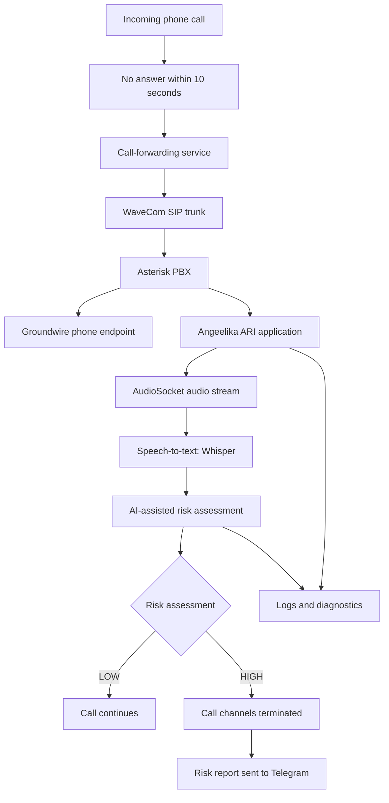

# Angeelika — System Architecture

## Overview

Angeelika is an experimental prototype for AI-assisted phone scam
risk assessment. It combines telephony, audio processing, speech
recognition and AI-based risk analysis.

## Architecture diagram

## Main components

### Telephony

Asterisk handles SIP telephony and coordinates the call flow.
The call-forwarding service routes unanswered calls to the SIP
telephony infrastructure.

### Call handling

The Groundwire endpoint is used to receive the call.
The Angeelika ARI application coordinates call handling and
audio-processing actions.

### Audio processing and speech recognition

Audio is streamed to a dedicated processing service through
AudioSocket. Whisper converts speech into text for analysis.

### Risk assessment

An AI-assisted assessment evaluates recognized text for potential
indicators of telephone fraud. A LOW result allows the call to
continue. A HIGH result triggers termination of the associated
call channels and a Telegram risk report.

The assessment is experimental and can produce false positives
or miss suspicious conversations.

### Telegram

Telegram receives risk reports. A separate Telegram bot provides
a conversational interface.

## Engineering work

- Python application development
- Linux server administration and service management
- Asterisk and SIP telephony integration
- Audio streaming and speech-to-text integration
- AI API integration and risk assessment
- Troubleshooting and iterative testing
- Evaluation of detection quality and false positives

## Limitations

This is a prototype under active development. Detection quality,
reliability, privacy requirements and deployment readiness require
further evaluation.

## Security

This public document describes the system at a high level.
It excludes phone numbers, credentials, private configuration,
personal data, call recordings and internal detection rules.
